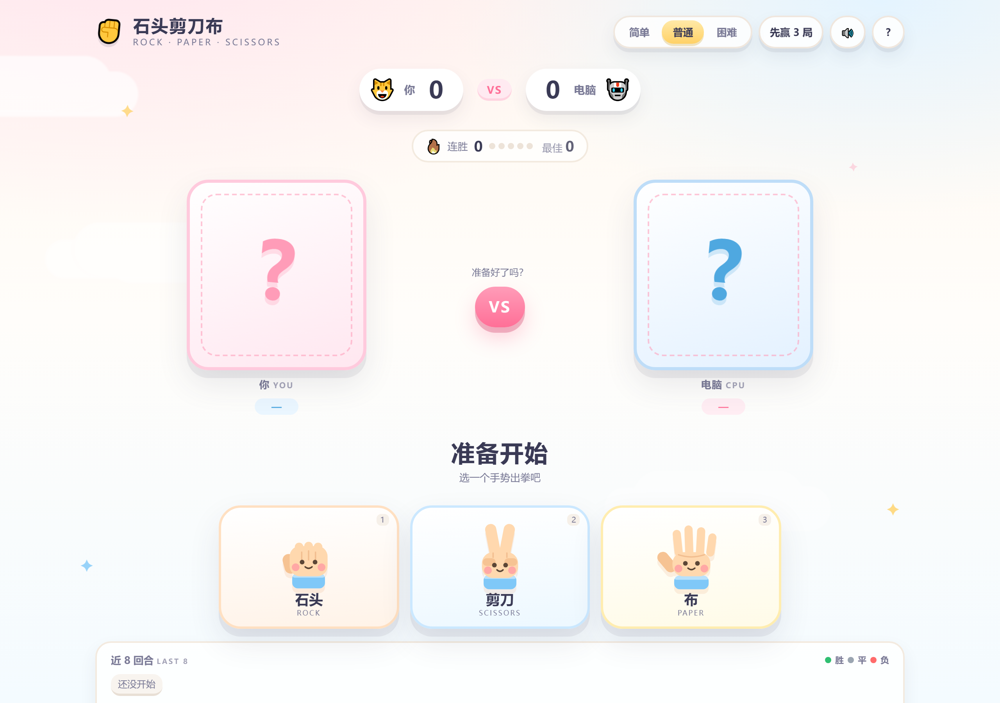
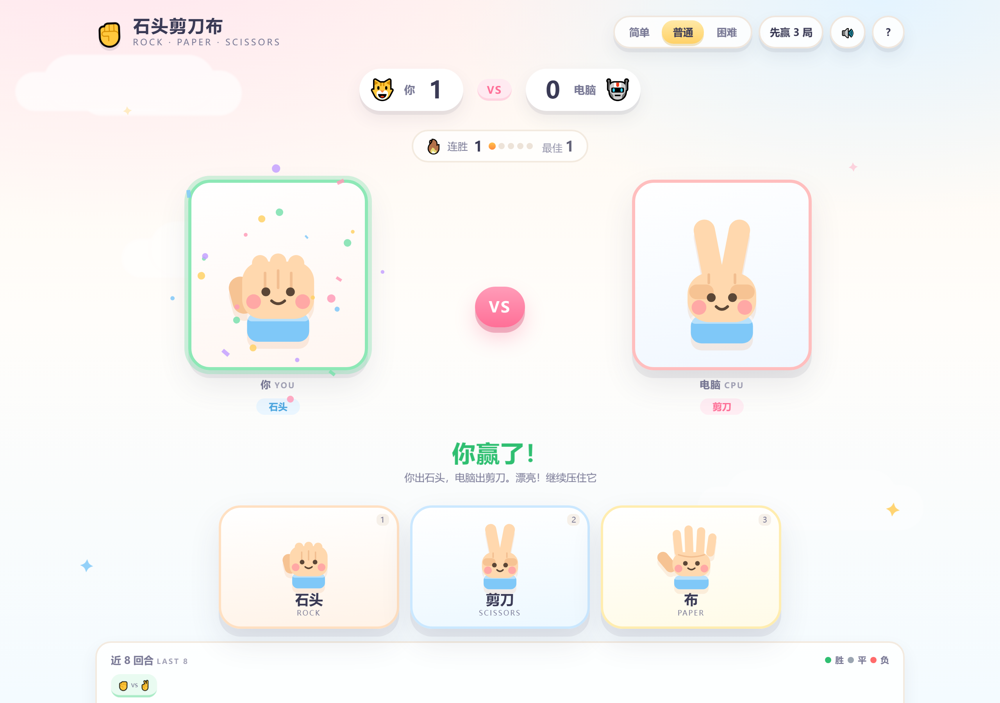
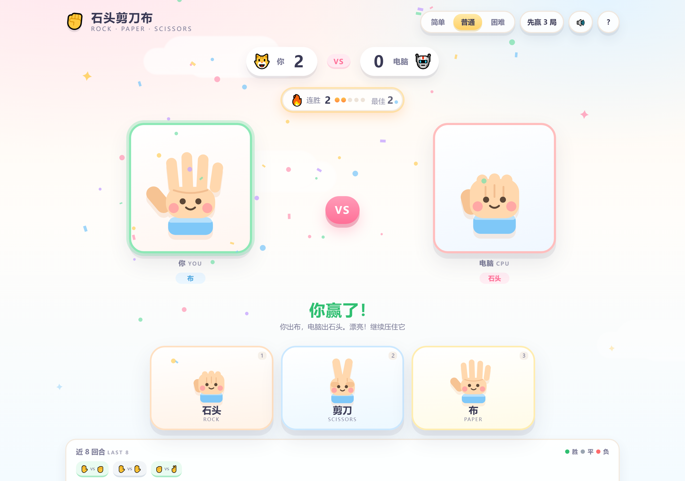
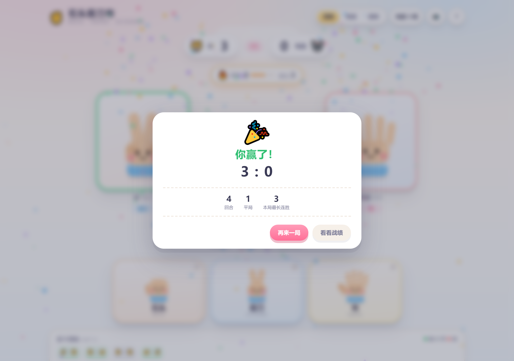
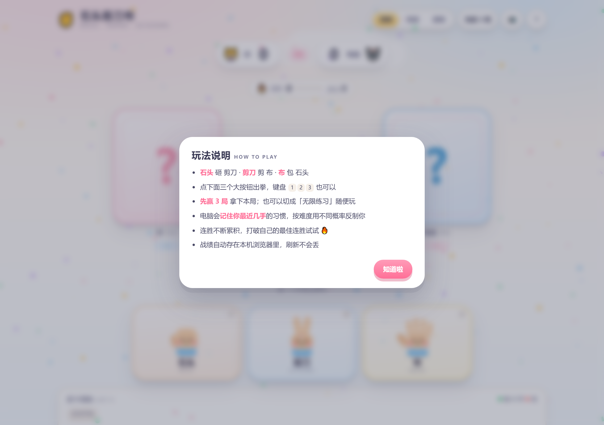
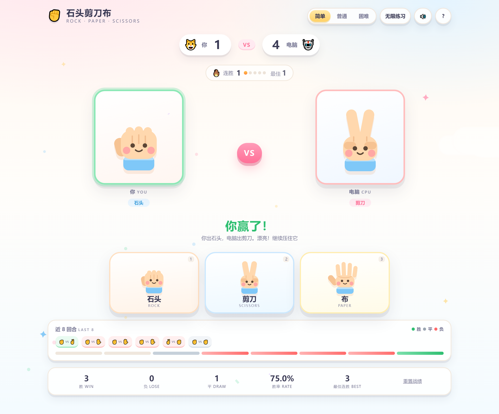
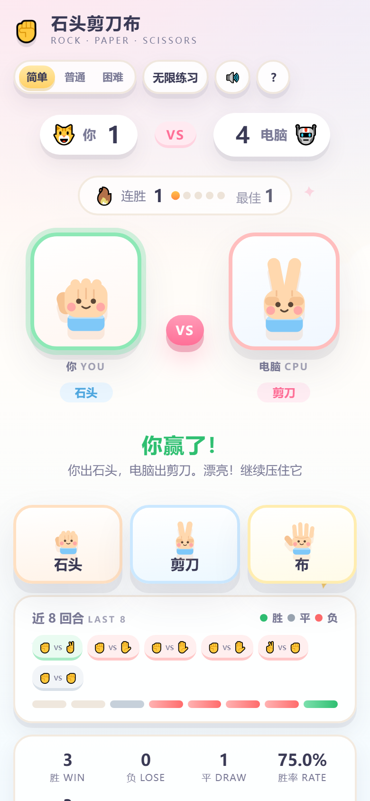
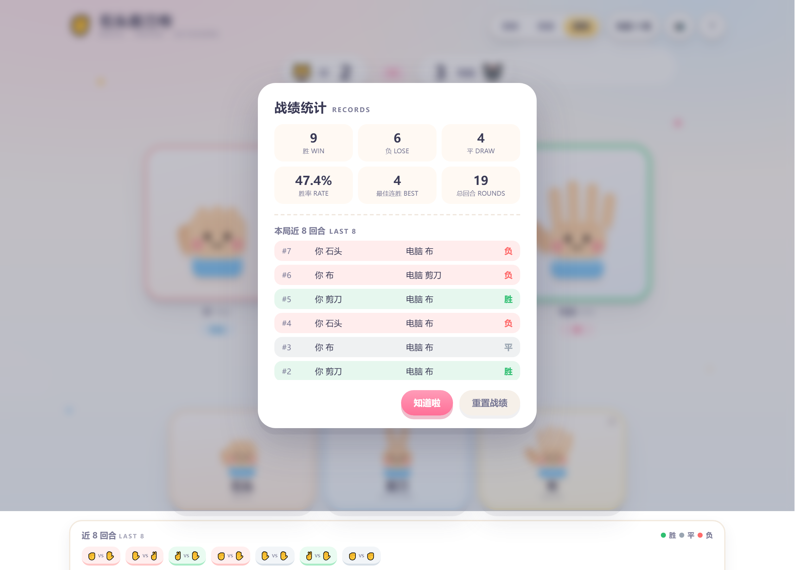

# 石头剪刀布 · Rock Paper Scissors

一个用纯 HTML / CSS / JavaScript 写的石头剪刀布小游戏：卡通可爱风、有倒数动画和翻牌、
会读心的电脑、战绩自动保存，手机也能玩。

> 面向对象程序设计 2 · 第 2 周作业（Vibe Coding 网页版）
> 学号 23102731 · 姓名 왕옥



---

## 功能一览

| 功能 | 说明 |
| --- | --- |
| 三种出拳方式 | 点下面三个大按钮，或者按键盘 `1` `2` `3` |
| 卡通手势卡片 | 手绘 SVG：握拳 / 剪刀手 / 张开的手掌，都带小脸和腮红 |
| 3D 翻牌 + 倒数 | 点下去玩家卡先翻，电脑卡抖一下再翻，中间「石头→剪刀→布→出拳！」 |
| 难度三档 | 简单 90/10、普通 70/30、困难 40/60（反制概率 / 随机概率），困难记得你最近 8 手 |
| 局制切换 | 「先赢 3 局」或「无限练习」 |
| 连胜火焰 | 连胜 2 场以上火焰点亮，通关动画 + 最佳连胜记录 |
| 礼花与音效 | 赢一局爆彩纸、连胜全屏再炸一次；8 种音效全部用 Web Audio 现场合成，可静音 |
| 战绩 | 最近 8 回合（手势 + 结果胶囊 + 趋势条）、生涯胜/负/平/胜率/最佳连胜，存 localStorage |
| 结算弹层 | 本局比分、回合数、平局数、本局最长连胜，背景高斯模糊 |
| 手机适配 | 760px / 420px 两个断点，390×844 手机视口已实测 |

### 截图

| 对战 | 赢一局 |
| --- | --- |
|  |  |

| 结算 | 玩法说明 |
| --- | --- |
|  |  |

| 完整页面（含战绩） | 手机视图 |
| --- | --- |
|  |  |
|  | |

---

## 怎么运行

**最简单**：双击 `index.html`，浏览器直接就能玩。

**模拟线上环境**（本地起一个静态服务器，和 GitHub Pages 一样走 http）：

```bash
python -m http.server 8765
# 浏览器打开 http://127.0.0.1:8765/
```

---

## 项目结构

```
.
├── index.html          页面结构 + 手绘 SVG 手势（<defs> 里定义三只手）
├── css/
│   └── style.css       全部样式与动画
├── js/
│   ├── game.js         规则内核：判定、计分、连胜、近期战绩、生涯存档、自测
│   ├── ai.js           电脑出拳策略：三档难度 + 记住最近几手的反制逻辑
│   ├── sound.js        Web Audio 合成音效（不加载任何音频文件）
│   └── ui.js           界面流程：翻牌、倒数、礼花、结算、按钮事件
├── docs/               提交文档（功能说明、开发日志）
└── shots/              运行截图
```

**分层原则**：`game.js` 只管规则、不碰 DOM；`ai.js` 只管出拳策略；`ui.js` 只管画面。
所以规则内核和第 1 周的 C++ 版本是一一对应的，换界面不用改规则。

---

## 关键实现

1. **动画只改 `transform` 和 `opacity`**，不改 `width/height/top/left`，不触发重排，稳定 60 帧；
   统一弹性缓动 `cubic-bezier(.34,1.56,.64,1)`，时长 150~400ms。
2. **结算放在动画之后**：先播倒数、再抖电脑卡，最后才调用 `game.playRound()`，
   比分只会在"揭晓"那一刻跳，不会提前泄露结果。
3. **翻牌**用 `perspective` + `preserve-3d` + `backface-visibility: hidden`；
   新一局先用 `.no-anim` 关掉过渡强制回背面，避免"倒着翻回去"。
4. **礼花**用 canvas + `requestAnimationFrame` 的粒子系统（重力 + 淡出）。
5. **连胜规则**：平局不断连胜，输了才断（和第 1 周 C++ 版一致）。

---

## 自测

打开页面按 `F12`，在控制台输入：

```js
RpsDemo.selfTest(4000)
```

会跑 6 项检查：规则判定 9 种组合、随机胜率区间、只出石头的胜率（验证电脑会读心）、
经典模式必然结束、无限模式不会结束、近期战绩条数、生涯存档写入/读回一致。

正常输出：

```
==== 自测开始 SELF TEST (4000 rounds) ====
  [PASS] 规则判定 9 种组合全部正确
  [PASS] 随机出拳胜率 32.13%（应为 28%~39%）
  [PASS] 只出石头胜率 24.15%（< 30%，说明电脑会读心）
  [PASS] 经典模式一定能结束（用了 8 回合）
  [PASS] 无限模式 1000 回合不会结束
  [PASS] 近期战绩保留 8 条（实际 8）
  [PASS] 生涯战绩写入 / 读回一致
==== 自测结束 SELF TEST DONE: ALL PASS ====
```

---

## 浏览器支持

Chrome / Edge / Firefox / Safari 近两年的版本均可（用到了 CSS 变量、`aspect-ratio`、
`backface-visibility`、Web Audio）。不支持时动画会自动降级，不影响游戏逻辑。
